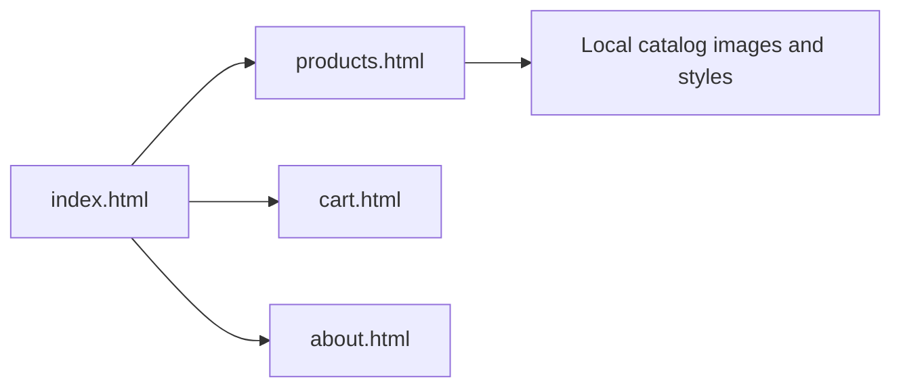

# Invictine Retail

A school storefront prototype for a fictional fantasy catalog, with separate product, cart, and shop information pages.

## Explore the prototype

1. Clone or download the repository and serve the `Ecommerce site` directory as the web root.
2. Open `index.html`, then choose **Products** to browse the catalog or **Cart** to inspect the sample checkout layout.

```sh
cd "Ecommerce site"
python -m http.server 8000
```

Visit [localhost:8000](http://localhost:8000). The catalog and cart are static examples. Some original carousel dependencies are absent from this snapshot.
## Page structure



This is a static classroom storefront prototype. The catalog, cart, and checkout states are examples; the repository does not provide a production commerce backend.