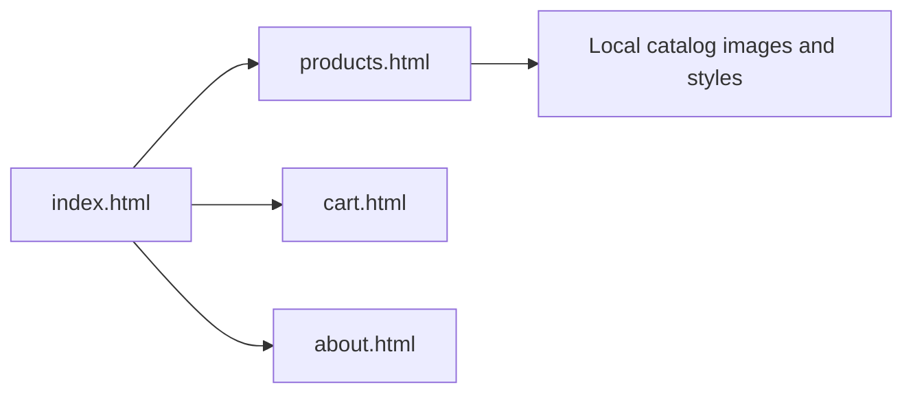

# Invictine Retail

I wanted this school storefront to feel like a shop you could wander through: a fantasy catalog, separate product and cart pages, and the supporting shop information all work together as one static experience. The cart and checkout are visual demos, not real commerce. Fork the layout, swap in your own catalog, and tell me what you would build next. Review the setup instructions and architecture below, or fork the repository to adapt the implementation to your requirements.

[](media/walkthrough.mp4)
*Click preview above to watch recorded interface demo.*


## Explore the prototype

1. Clone or download the repository and serve the `Ecommerce site` directory as the web root.
2. Open `index.html`, then choose **Products** to browse the catalog or **Cart** to inspect the sample checkout layout.

```sh
cd "Ecommerce site"
python -m http.server 8000
```

Visit [localhost:8000](http://localhost:8000). The catalog and cart are static examples. Some original carousel dependencies are absent from this snapshot.
## Page structure



This is a static classroom storefront prototype. The catalog, cart, and checkout states are examples; the repository does not provide a production commerce backend.
