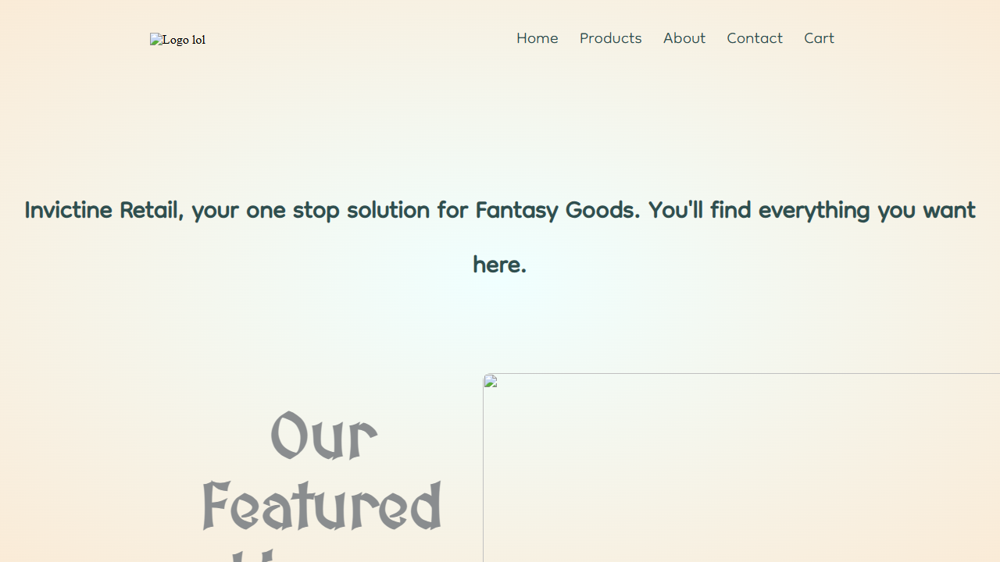

# Invictine Retail · E-Commerce Catalog

> **Modular multi-category e-commerce storefront with client-side cart calculations.**

*Click the preview card above to watch the storefront walkthrough.*

---

## Why I Built This

A clean, responsive retail catalog prototype exploring client-side cart state management, category filtering, and product photography presentation without relying on heavy third-party e-commerce platforms.

## Standout Features

- **Multi-Category Navigation:** Dynamic category filtering with instantaneous DOM updates.
- **Client-Side Cart:** Persistent cart state using LocalStorage with item quantity adjustments and tax calculations.
- **Rich Product Details:** High-resolution product image gallery and structured specifications.

## Media

- **Storefront Screenshot:** `media/overview.png`
- **Recorded Walkthrough:** `media/walkthrough.mp4`

## Running Locally

Open `Ecommerce site/index.html` directly in any browser.
